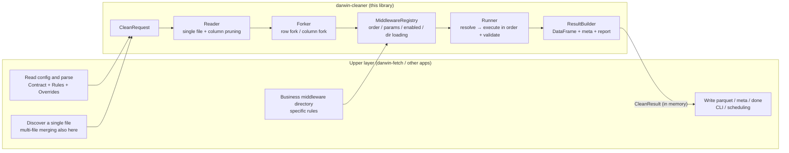
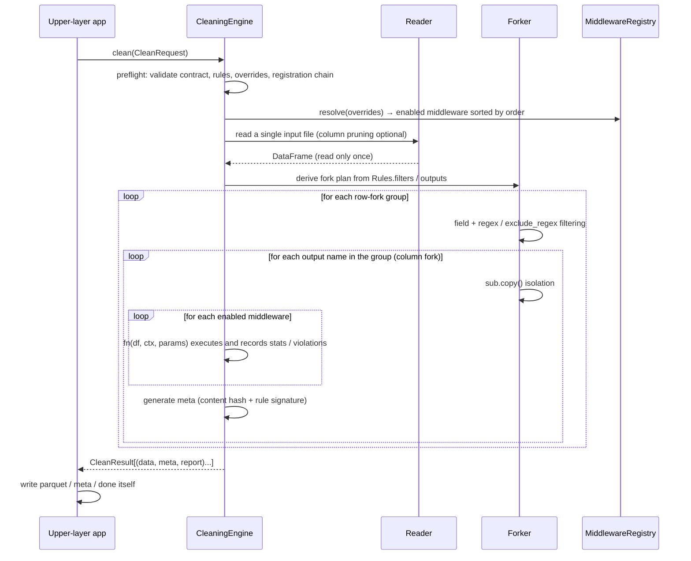

# darwin-cleaner Design Document (v0.4)

[English](design.md) · [简体中文](design.cn.md)

> Status: design draft. It defines only boundaries, architecture and interfaces, no implementation.
> v0.2: input narrowed to a **single parquet**; source-specific middleware are not migrated; business concepts such as `source` / `clean_type` are stripped out; the **order mechanism** is confirmed; `builtins()` and `load_middlewares_from_dir(path)` are added; a row-forking explanation is added.
> v0.3: zero-row output is handled as an error; all on-disk formats become the upper-layer writer's responsibility; duplicate middleware names fail at registration time; `FieldSpec.required` controls missing-column behavior per column and `missing_output_policy` is removed; `Contract.keys` declares the unique row key.
> v0.4: middleware gains declarative `params` and a strongly-typed Options convention; an `enabled` switch (registration time + request-level overrides), skipped at the registry layer; `required` becomes tri-state with sort/keys auto-derivation; non-required missing columns are filled empty with no warning (toggled by an output parameter); deduplication is built in as the 12th middleware, disabled by default.

---

## 1. Positioning

darwin-cleaner is a **pure cleaning engine library**: it reads **one** parquet (or an in-memory DataFrame), performs row forking and column forking according to contracts and rules injected by the upper layer, executes enabled middleware in **order** sequence, and returns the data and metadata of each fork in memory.

One-sentence responsibility: **read a single file → fork → run the chain in order → return data and meta**.

### 1.1 Design goals

| Goal | Meaning |
|---|---|
| Correctness | contracts are validated before execution; errors are not silently downgraded; statistics and report fields all have real writers; output is deterministic and reproducible |
| Speed | a single file is read once; prune by column; forks share the read result; execution plans are cached; avoid per-row `apply` |
| Pluggability | middleware declares `order`, is configured via `params`, and toggled via `enabled`; instance-level registration; user directories can be loaded |
| No business concepts | no knowledge of `source` / `clean_type` / `raw_type` / dates / breakpoints; only contracts, rules and DataFrames |
| No IO side effects | no file writes, no breakpoint reads, no CLI exit codes; only data transformation and metadata generation |

### 1.2 Non-goals (explicitly out of scope)

- reading and merging multiple parquet files (done by the upper layer; the library accepts a single file)
- loading `cleaner.json` / `clean.d/*.json` / any configuration file
- file discovery, path filtering, freshness determination
- reading fetch breakpoints, resolving done paths, writing clean breakpoints
- writing parquet / meta.json / report files; serialization and persistence of **any file format** (parquet / csv / ...) are the upper-layer writer's responsibility; the library only returns DataFrames in memory
- CLI parameter definitions, exit code mapping, batch scheduling, wrapper idempotence
- any data-source-specific business rule (`stk_limit` / `gold_sge` / `trd_calendar` / `stk_code` / `stk_hkcode` / `ftshare` / `ohlcvault` / `json_extract`, etc.)
- facade orchestration (`Cleaner` class) and selectors scanning

---

## 2. Boundary mapping (what to migrate from the existing code)

| Existing file / logic | Treatment | Notes |
|---|---|---|
| `task.py`: fork resolution, row filtering, column forking, chain execution, statistics collection, meta generation | **Migrate and refactor** | remove path concatenation, file writing and done lookup; keep forking and chain execution |
| `task.py`: `load_data()` | **Migrate as a single-file Reader** | read only one parquet; support column pruning; multi-file merging is left to the upper layer |
| `task.py`: `save_data()` / `_write_meta()` / `_compute_hash()` | **Split** | meta generation migrates; file writing and paths go to the upper layer; hash is based on DataFrame content |
| `middlewares/base.py`: registration, order sorting, lookup | **Migrate and extend** | instance-level registry; remove `clean_type` / `source` scoping; add `params` / `enabled` |
| `middlewares/steps.py`: 11 global steps | **Migrate as built-in middleware** | explicit registration via `builtins()`; switch from `get_config` to reading `ctx.rules` / `ctx.contract` / `params` |
| deduplication logic | **Add as a built-in middleware** | no dedupe in the existing code; add `dedupe(70)`, disabled by default |
| `middlewares/{stk_limit,gold_sge,trd_calendar,stk_code,stk_hkcode,ftshare,ohlcvault,json_extract,stk_ohlcv}.py` | **Not migrated** | business/source-specific rules; the upper layer may rewrite them as generic middleware and load them via `load_middlewares_from_dir()` |
| `context.py` | **Migrate and simplify** | remove output_path, CLI options, done and identity fields; keep output_key / contract / rules / report |
| `contract.py`: `FieldSpec` / contract types and merge validation | **Migrate types, drop loading** | `load_contract` / `ensure_loaded` / `list_clean_types` stay in the upper layer; `CleanContract` → `Contract` |
| `report.py` / `result.py` / `exceptions.py` | **Migrate and strengthen** | remove exit_code, business identifiers and path semantics; fill in the statistics writers |
| `cleaner.py` (facade), `actions/`, Shell scripts | **Not migrated** | upper-layer application responsibilities |
| `clean.d/*.json`, `cleaner.json`, `adapters/*/adapter_clean.json` | **Not migrated** | read by the upper layer and injected |

---

## 3. Overall architecture



### 3.1 Layered responsibilities

1. **Value-object layer**: `Contract` / `FieldSpec` / `Rules` / `CleanRequest` / `CleanMeta` / `CleanReport` / exceptions — no IO, no global state and no business identifiers.
2. **Registry layer**: `MiddlewareRegistry` — instance-level registry, sorted by `order`, behavior configured by `params`, toggled by `enabled`; `builtins()` registers 12 built-in steps; `load_middlewares_from_dir()` loads user middleware.
3. **Execution layer**: `CleaningEngine` — reads a single file, forks, executes in order and aggregates the results; no filesystem write side effects.

---

## 4. Core data flow



### 4.1 Why row forking is needed

The root cause is that **the granularity returned by the upstream interface ≠ the granularity of downstream data products**: a raw file mixes data of several semantics and must be split by row, otherwise type-A data would be written into a type-B table. Real examples from the existing configuration:

| Upstream | Symptom | Row-fork approach |
|---|---|---|
| baostock `stock_code` | one file returns stock, ETF and index codes at once | split into three groups by `code` regex: `sh.60/sz.00…` → `stk_code`, `sh.51/sz.15…` → `etf_code`, `sh.000/sz.399…` → `stk_index_code` |
| tushare `fund_code` | ETFs and "feeder funds" are mixed together | exclude rows containing "联接" by `name` regex, keep only ETFs → `etf_code` |

**Column forking is an orthogonal dimension**: one baostock `stock_daily` raw file carries quotes, valuation, turnover and ST fields at once; the rows are the same but are projected separately into `stk_ohlcv` / `stk_valuation` / `stk_turnover` / `stk_st`.

Model:

```
one raw file
 ├─ row fork (field + regex): rows of different semantics go to their own groups
 │    └─ column fork (output_names): same rows within a group, different columns
 └─ each combination runs the chain and produces output independently
```

The new library keeps the forking capability, but uses neutral `output_key` / `output_names` for outputs, not bound to `clean_type`.

### 4.2 Fork semantics

- **Row fork**: `Rules.filters` is `{key: RowForkSpec}`; if the `field` column does not exist, no filtering is applied (all rows pass); `regex` and `exclude_regex` may both be present (a row is a hit only when both are satisfied).
- **Column fork**: each output has its own `Contract.output`, which determines the column set and column order.
- **Row overlap**: the same row may enter multiple groups; each group uses `sub.copy()` for isolation to avoid column filtering cross-contaminating other groups.
- **No filters**: degenerates into a single group `"all"` using `Rules.outputs`.
- The fork plan may also be injected directly by the caller via `fork_plans`, bypassing rule resolution.

### 4.3 Chain execution (the order mechanism)

- `resolve(overrides)` returns **enabled** middleware, stably sorted by `(order, registration index)`; specs with `enabled=False` are skipped **at the registry layer** — they do not enter the execution plan and are not called.
- No `clean_type` / `source` scope filtering.
- Every middleware has the uniform signature `(df, ctx, params) -> df | None`; returning `None` means no change. `params` come from the registered value and may be overridden at request level.
- order segments follow the existing convention: `10-19` preprocessing, `20-29` dtype, `30-39` filling, `40-49` formulas, `50-69` validation/dedupe, `90-99` output. User middleware may use any order (e.g. `100+` for post-processing).
- **Error policy**: configuration errors, validation failures and **zero-row output** all follow the error path (throw `CleanerDataEmptyError`, etc.); other exceptions terminate that fork under `strict=True` (the default), while under `strict=False` a warning is recorded and `degraded=True` is marked, preventing silently dirty data.

---

## 5. Key concepts

### 5.1 Contract

A generic contract parsed and merged by the upper layer from `clean.d/*.json` and then injected, containing fields, types, output columns, unique row keys and sorting. `Contract.name` is only a diagnostic label, not a `clean_type`.

**Field requiredness (`FieldSpec.required` tri-state)**:
- `True`: error if the column is missing;
- `False`: missing explicitly allowed, fill with an empty column;
- `None` (default, undeclared): derived by `Contract.is_required(field)` — fields participating in `sort` or `keys` are `True`, all others are `False`.

This makes sort columns naturally required without requiring the upper layer to edit every contract, while preserving the ability to declare an explicit `False`. preflight only checks "whether derived required columns are defined in fields"; it does not require an explicit `True`.

**Unique row key (`Contract.keys`)**:
- a tuple of compound columns; an empty tuple means no unique-row distinction and duplicate rows are allowed (this is also the current actual behavior of darwin-fetch — `duplicates_removed` is always 0 and there is no deduplication code anywhere);
- when non-empty, these columns are automatically derived as `required=True` and must be present in `output`;
- whether and how to deduplicate is controlled by the `dedupe` middleware params (disabled by default, see 6.2).

**Preflight validation**:
1. `output` is non-empty and every column is in `fields`;
2. every `FieldSpec.type` is defined in `types`;
3. formula dependency fields can be statically analyzed and checked for absence in advance;
4. fields derived as required by `is_required()` must be defined;
5. `sort` / `keys` fields are allowed to be absent from `output`, but a warning is recorded.

### 5.2 Rules

Generic rules parsed and injected by the upper layer, replacing global configuration reads inside middleware:

| Rule section | Purpose | Corresponding built-in middleware |
|---|---|---|
| `mapping` | source field → contract field | `field_mapping` |
| `value_map` | field value replacement | `value_mapping` |
| `transform` | constants / factors / actions | `field_transform` |
| `json_extract` | extract from dict columns | user middleware (not built in) |
| `filters` | row-fork groups | Forker |
| `outputs` | default column fork | Forker |

### 5.3 CleanRequest

The sole entry-point parameter:
- `input`: a **single** parquet path or an in-memory DataFrame;
- `contracts`: `output name -> Contract` (only the ones needed for this run);
- `rules`: generic rules;
- `options`: `strict` / `hash_algorithm` / column pruning / `middleware_overrides` (request-level middleware overrides);
- `fork_plans`: an optional explicit fork plan.

### 5.4 CleanContext

The runtime carrier of a single fork: `output_key` / `contract` / `rules` / `report` / `logger` / `data`.
It **does not contain** `source` / `clean_type` / `raw_type` / `date` / `filename` / `fetch_done_path` / `done_path` / `overwrite` / `check_only` / `csv_mode`.

### 5.5 CleanOutput / CleanMeta / CleanReport

- **CleanOutput** = `output_key` + `status` + `data` + `meta` + `report`, all in memory. `status ∈ {pending, success, failed, skipped}`, there is no `empty`; zero rows follow the error path.
- **CleanMeta** = row count, column set, content-based `data_hash`, rule fingerprint `rule_signature`, engine version, statistics and warnings. It **does not contain** business identifiers, paths, write time or breakpoint lookup.
- **CleanReport** = process audit; `to_dict()` is serializable; whether to persist it is decided by the upper layer.
- `rule_signature = hash(contract + rules + effective registry contents incl. params/enabled)`, used by the upper layer for idempotence / change detection, replacing the binary "does the file exist" semantics.

---

## 6. Middleware system

### 6.1 Declarative parameters (`params`)

- `MiddlewareSpec.params` is `Mapping[str, Any]`; the engine passes it **as-is** as the third argument to fn: `fn(df, ctx, params)`.
- params are serializable, comparable and counted in `rule_signature` — the same middleware with different params counts as a different rule chain.
- **Strongly-typed Options convention**: a middleware author may parse params inside fn into their own `@dataclass` Options (with defaults and validation), keeping declarative auditability while gaining type safety. `MiddlewareSpec.enabled_with()` / `with_params()` return a new spec, making it easy for the upper layer to derive variants.
- The decorator `@middleware(order, version=..., params=..., enabled=...)` attaches markers to the function; it does not perform registration.

### 6.2 Toggle mechanism (`enabled` + overrides)

- `MiddlewareSpec.enabled` is a registration-time switch; `resolve()` skips specs with `enabled=False` **at the registry layer** — they do not enter the execution plan, are not called and do not count toward the fingerprint.
- Request-level override: `CleanOptions.middleware_overrides: Mapping[name, MiddlewareOverride]`, overriding `enabled` / `params` by name; a field of `None` means inherit the registered value; an unknown name raises an error in preflight.
- Typical usage: register `dedupe` globally as disabled, then enable it per request for a contract that needs deduplication with `overrides={"dedupe": MiddlewareOverride(enabled=True, params={...})}`; or temporarily turn on `warn_on_missing` for `output`.
- Duplicate names: `register()` throws `CleanerRuleError` immediately on a duplicate `name` (a startup-time failure), with no overwrite and no silent skip; the upper layer catches this exception at startup, warns and exits.

```python
registry = MiddlewareRegistryImpl()
registry.builtins()                                  # register 12, dedupe off by default
for spec in load_middlewares_from_dir(Path("my_middlewares/")):
    registry.register(spec)

engine = CleaningEngine(registry)
result = engine.clean(CleanRequest(
    input=path,
    contracts=contracts,
    rules=rules,
    options=CleanOptions(
        middleware_overrides={
            "dedupe": MiddlewareOverride(
                enabled=True,
                params={"keys": ("symbol", "trade_date"), "strategy": "last"},
            ),
        }
    ),
))
```

### 6.3 Twelve built-in generic steps (`builtins()`)

| order | Name | Purpose | Default |
|---|---|---|---|
| 10 | `field_mapping` | field renaming | on |
| 12 | `value_mapping` | value replacement | on |
| 15 | `field_transform` | constants / factors / actions | on |
| 20 | `type_conversion` | dtype normalization (numeric/string/datetime/timestamp_ms) | on |
| 30 | `fill` | grouped ffill, statistics written to `nulls_filled` | on |
| 40 | `formula_compute` | compute all-empty columns by formula; partial absence only warns | on |
| 45 | `formula_validate` | dual-tolerance validation (only a simultaneous rel + abs overflow counts as a mismatch) | on |
| 50 | `consistency` | inter-field relationship validation | on |
| 60 | `type_validate` | inf / min / max out-of-range values set to null | on |
| 70 | `dedupe` | deduplicate by keys | **off** |
| 90 | `output` | select columns by contract; non-required missing columns filled empty, no warning by default | on |
| 95 | `sort` | multi-field sorting by contract | on |

Built-in steps read their parameters from `ctx.rules` / `ctx.contract` / `params`, **no longer from the global configuration tree**.

**`output` parameters**: `warn_on_missing: bool = False` (no warning by default). Non-required missing columns are always filled with an empty column; whether a warning is produced is controlled by this parameter, instead of warning globally.

### 6.4 Deduplication (`dedupe`, disabled by default)

- Built in as the 12th middleware, order=70, `enabled=False`. See 6.2 for how to enable it.
- **The definition and handling of duplicate rows are entirely controlled by params**:
  - `keys: tuple[str, ...]` — the columns used for duplicate detection; when empty, falls back to `Contract.keys`;
  - `scope: Literal["keys", "all_columns"]` — deduplicate by the specified columns or by the whole row;
  - `strategy: Literal["first", "last", "error"]` — keep the first / keep the last / raise an error on a duplicate;
  - `warn: bool` — whether to write the number of removed duplicates to the report.
- Enabled but both `keys` and `Contract.keys` are empty → preflight error (there is no way to define "duplicate").
- The `duplicates_removed` statistic is written by it; this metric does not appear when it is disabled. Thus the same engine can serve both "stream-type data that allows duplicates" and "strictly unique base tables".

### 6.5 User middleware directory

`load_middlewares_from_dir(path)`: scans the directory for Python functions marked with `@middleware` and returns `MiddlewareSpec`. It is a **code-loading helper**, not data-file discovery; whether to register is up to the caller. Duplicate-name conflicts are not swallowed at load time — `register()` throws `CleanerRuleError` immediately, and the upper layer warns and exits at startup.

Source-specific rules (invalid limit-up / limit-down values, gold main-contract filtering, trading-calendar timestamps, stock-code market inference, source-side symbol backfill, etc.) should be rewritten as generic middleware without business identifiers, placed in this directory and registered by the upper layer as needed.

### 6.6 Action registry

`register_action(name, fn)` extends the available actions for `field_transform`. Built-in actions: `symbol_to_standard` / `date_to_compact` / `datetime_to_compact` / `zero_to_nan` / `symbol_suffix` / `us_symbol_suffix` / `float_to_compact`. Unknown actions raise an error in preflight, not a runtime warning.

---

## 7. Performance design

| Problem (current state) | New library approach |
|---|---|
| each raw file is read once and multiple forks copy from the same frame | a single file is read once; column pruning is derived from contracts |
| source-specific rules use `df.apply(axis=1)` row by row | not in the library; vectorization is recommended when rewriting them |
| the registry is sorted on every traversal | the registry caches the sorted result by registration order; `resolve` filters disabled entries before sorting |
| formula dependency fields are re-extracted by regex every time | parsed and cached during preflight |
| execution continues after a middleware failure | strict fail-fast by default |

---

## 8. Correctness design

| Current problem | New library countermeasure |
|---|---|
| non-config / non-validation exceptions are downgraded to warnings, possibly silently producing dirty data | strict failure by default; lenient mode must mark `degraded=True` |
| `CleanReport.save()` is never called | the library does not persist; `to_dict()` is fully serializable and the upper layer decides where to persist |
| `duplicates_removed` / `nulls_backfilled` / `validation_errors` have no writers | keep only statistics with a clear writer; `duplicates_removed` is written by `dedupe`, absent when it is disabled |
| contracts are read from the global configuration tree and are easily mutated externally | immutable value objects are injected; no global config reads during execution |
| `output` silently fills missing columns with None | derive behavior from the `FieldSpec.required` tri-state: required → error, non-required → empty; warnings are controlled by the output's `warn_on_missing` parameter, no warning by default |
| meta hash is based on the written file | changed to be based on DataFrame content, independent of format / compression |
| inconsistent violation-handling semantics | unified `ViolationAction` (null / flag / reject) |

---

## 9. Integration with the upper layer (pseudocode)

```python
# Upper layer: parse config (not inside the library)
contracts = {name: build_contract(cfg) for name, cfg in cfg_contracts.items()}
rules = parse_rules(cfg_adapter)

# Upper layer: discover a single file (not inside the library); multi-file merging is also here
path = discover_single_parquet(...)

# Upper layer: prepare middleware (business rules are not decided in the library)
registry = MiddlewareRegistryImpl()
registry.builtins()                          # 12 steps, dedupe off by default
for spec in load_middlewares_from_dir(Path("my_middlewares/")):
    registry.register(spec)

# Call the engine (library boundary); override middleware per request when needed
engine = CleaningEngine(registry)
result = engine.clean(CleanRequest(
    input=path,
    contracts=contracts,
    rules=rules,
    options=CleanOptions(
        strict=True,
        middleware_overrides={
            "dedupe": MiddlewareOverride(
                enabled=True,
                params={"scope": "keys", "strategy": "last", "warn": True},
            ),
        },
    ),
))

# Upper layer: persistence (not inside the library)
for out in result.outputs:
    if out.status == "success":
        write_parquet(out.data, path_for(out.output_key))
        write_meta({**out.meta.to_dict(), "data_path": rel_path,
                    "cleaned_at": now(), "clean_done": done_rel})
write_clean_done(result)
```

---

## 10. Migration roadmap

1. **Freeze the value objects**: implement `Contract` / `Rules` / `CleanReport` / `CleanMeta` / exceptions / `MiddlewareOverride` according to this interface; the upper layer writes adapter functions to construct them from the existing JSON.
2. **Migrate the 11 generic steps in `steps.py`**: replace `get_config` with `ctx.rules` / `ctx.contract` / `params` one by one; orders stay the same.
3. **Implement the dedupe step**: add `dedupe(70)`, implement it with the 6.4 params semantics, disabled by default.
4. **Switch engines**: refactor `CleanTask` into `CleaningEngine` (single-file input + forking + order-based chain); compare old and new DataFrames with golden tests.
5. **Move source-specific rules out**: rewrite the 9 specific modules as generic middleware without business identifiers and place them in the upper-layer directory.
6. **Upper layer takes over IO and business logic**: the facade, breakpoints, CLI, exit codes and persistence all remain in darwin-fetch.

### 10.1 Decision status

1. **Decided**: zero-row output is handled as an error just like a validation failure — throw `CleanerDataEmptyError`; `Status` does not include `empty`.
2. **Decided**: the library only returns DataFrames; serialization and persistence of any file format (parquet / csv / etc.) are the upper-layer writer's responsibility.
3. **Decided**: middleware with duplicate names throw `CleanerRuleError` immediately at registration (a startup-time failure), with no overwrite and no silent skip; the upper-layer application warns and exits at startup.
4. **Decided**: missing-column behavior is determined by the `FieldSpec.required` tri-state, with sort / keys auto-derived as required; non-required columns are filled empty with no warning by default (see 5.1 / 6.3).
5. **Decided**: `Contract.keys` declares unique row keys; deduplication is built in as `dedupe(70)` and disabled by default, with the definition and handling of duplicate rows controlled by params (see 6.4).
6. **Decided**: middleware uses declarative `params` plus a strongly-typed Options convention; `enabled` is a registration-time switch combined with request-level overrides and is skipped at the registry layer (see 6.1 / 6.2).

### 10.2 Missing-column handling: why `missing_output_policy` was removed

The `output` step (order=90) in the existing `steps.py` has two distinct cases:
- an output column is **undefined** in the contract `fields` → throw `CleanerConfigError` directly (a hard error);
- an output column is **defined** in the contract, but the input DataFrame **does not have that column** → silently execute `df[field] = None`, producing an all-null column.

The original design tried to control the second case with a global `null/reject` switch, but that is the wrong abstraction: within the same output, some columns (e.g. extension fields, optional metrics) meaningfully become empty when absent, while others (e.g. sort keys, unique row keys and core business fields) must raise an error when absent. A global policy cannot express both at once.

It is now changed to a **per-column tri-state declaration**: explicit `required=True` raises an error, explicit `False` fills an empty column, and undeclared columns are derived from sort / keys. Warning is no longer the default behavior but is enabled on demand via the `output` parameter `warn_on_missing`. There is no `missing_output_policy` field in `CleanOptions`.

### 10.3 Unique rows and duplicate rows

- `Contract.keys` is a tuple of compound columns; **empty = no unique-row distinction, duplicate rows allowed** (corresponding to the current actual behavior of darwin-fetch: there is no deduplication code anywhere in the repository and `duplicates_removed` is a dead metric permanently equal to 0).
- When non-empty, each `keys` column is derived as `required=True` and must be present in `output`; this is the contract declaration that "the data should be unique".
- `dedupe(70)` is built in but disabled by default. When enabled, duplicates are determined by the `keys` / `scope` defined in params, handled according to `strategy` (first / last / error), and `duplicates_removed` is written.
- Therefore the same engine can serve both "stream / event-type data that allows duplicates" and "strictly unique base tables".

---

## 11. Interface file index

| File | Contents |
|---|---|
| `src/darwin_cleaner/contract.py` | `Contract` (with `keys`, `is_required`, `dedupe_keys`) / `FieldSpec` (with tri-state `required`) / `TypeSpec` / `FillSpec` / `SortSpec` |
| `src/darwin_cleaner/rules.py` | `Rules` / `TransformSpec` / `JsonExtractSpec` / `RowForkSpec` / `ForkPlan` |
| `src/darwin_cleaner/request.py` | `InputData` / `ReadOptions` / `CleanOptions` (with `middleware_overrides`) / `CleanRequest` |
| `src/darwin_cleaner/context.py` | `CleanContext` / `Logger` |
| `src/darwin_cleaner/results.py` | `CleanOutput` / `CleanMeta` / `CleanReport` / `CleaningStats` / `ValidationIssue` / `CleanResult` |
| `src/darwin_cleaner/middleware.py` | `MiddlewareFn` / `MiddlewareSpec` (with `params` / `enabled`) / `MiddlewareOverride` / `middleware` / `builtin_middlewares` / `load_middlewares_from_dir` / `MiddlewareRegistry` |
| `src/darwin_cleaner/engine.py` | `CleaningEngine` / `CleanPlan` / `CleanStep` (with `params`) / `clean()` |
| `src/darwin_cleaner/exceptions.py` | exception hierarchy |
| `src/darwin_cleaner/__init__.py` | public API exports |

> Interface files define only type signatures and semantic contracts; method bodies are placeholders and contain no implementation logic.
