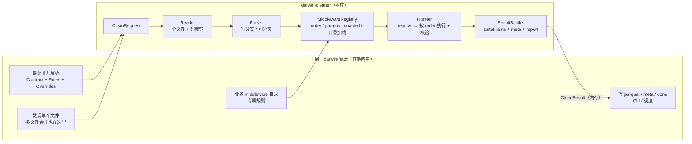
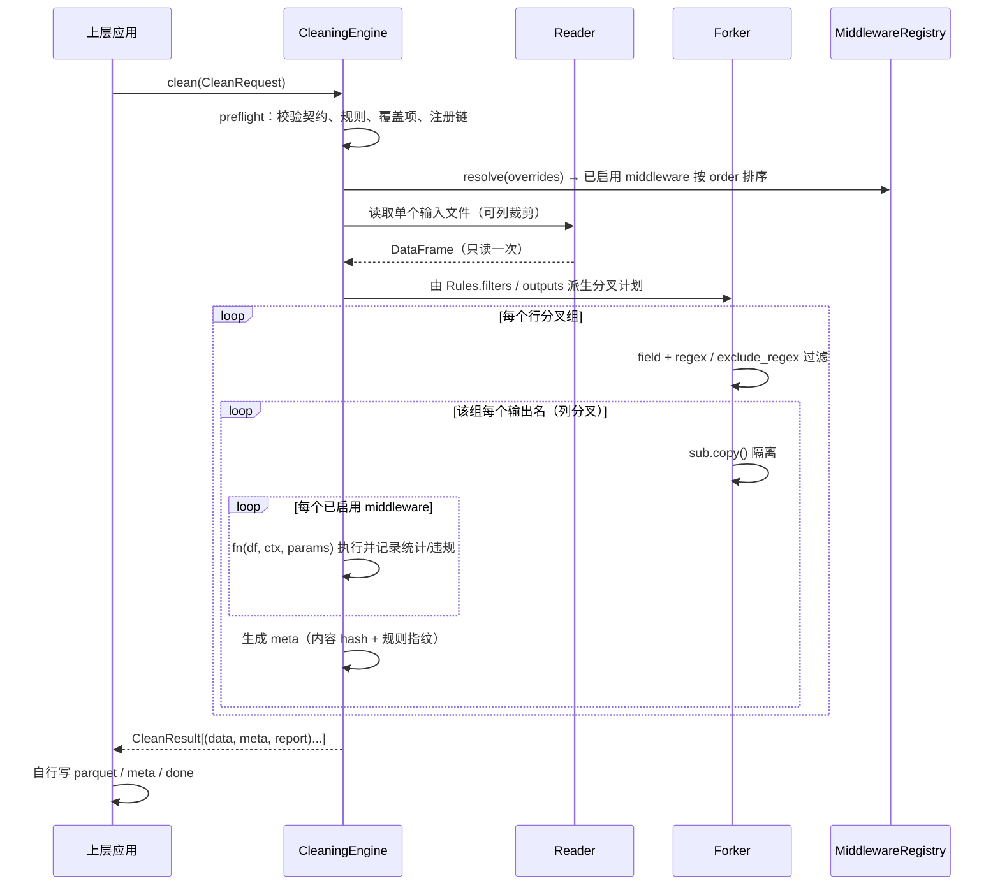

# darwin-cleaner 设计文档（草案 v0.4）

> 状态：设计草案，仅定义边界、架构与接口，不含实现。
> v0.2：输入收窄为**单个 parquet**；专属 middleware 不迁入；剥离 `source` / `clean_type` 等业务概念；确认 **order 机制**；新增 `builtins()` 与 `load_middlewares_from_dir(path)`；补充行分叉说明。
> v0.3：0 行输出按错误处理；写盘格式全归上层 writer；同名 middleware 注册期失败；`FieldSpec.required` 逐列控制缺列行为并取消 `missing_output_policy`；`Contract.keys` 声明唯一行键。
> v0.4：middleware 增加声明式 `params` 与强类型 Options 约定；`enabled` 开关（注册期 + 请求级 overrides），注册表层跳过；`required` 改三态，sort/keys 自动推导；非 required 缺列补空且不告警（由 output 参数开关）；去重内置为第 12 个 middleware，默认关闭。

---

## 1. 定位

darwin-cleaner 是一个**纯清洗引擎库**：读取**一个** parquet（或内存 DataFrame），按上层注入的契约与规则做行分叉、列分叉，按 **order 顺序**执行已启用的 middleware，在内存中返回每个分叉的数据和元数据。

一句话职责：**读取单文件 → 分叉 → 按 order 跑链 → 返回数据与 meta**。

### 1.1 设计目标

| 目标 | 含义 |
|---|---|
| 正确 | 契约先校验后执行；错误不被静默降级；统计与报告字段都有真实写入方；输出确定、可复现 |
| 快速 | 单文件只读一次；按列裁剪；分叉共享读取结果；执行计划缓存；避免逐行 `apply` |
| 可插拔 | middleware 以 `order` 声明、以 `params` 配置、以 `enabled` 开关；实例级注册；用户目录可加载 |
| 无业务概念 | 不认识 `source` / `clean_type` / `raw_type` / 日期 / 断点；只认识契约、规则、DataFrame |
| 无 IO 副作用 | 不写文件、不读断点、不产生 CLI 退出码；只做数据变换与元信息生成 |

### 1.2 非目标（明确不做）

- 多 parquet 文件读入与合并（上层完成，库只接单文件）
- 加载 `cleaner.json` / `clean.d/*.json` / 任何配置文件
- 文件发现、路径过滤、新鲜度判定
- 读取 fetch 断点、解析 done 路径、写 clean 断点
- 写出 parquet / meta.json / 报告文件；**任何文件格式**（parquet / csv / ...）的序列化与写盘都是上层 writer 的责任，库只在内存中返回 DataFrame
- CLI 参数定义、退出码映射、批量调度、wrapper 幂等
- 任何数据源专属业务规则（`stk_limit` / `gold_sge` / `trd_calendar` / `stk_code` / `stk_hkcode` / `ftshare` / `ohlcvault` / `json_extract` 等）
- 门面编排（`Cleaner` 类）与 selectors 扫描

---

## 2. 边界映射（从现有代码迁移什么）

| 现有文件 / 逻辑 | 处理方式 | 说明 |
|---|---|---|
| `task.py`：分叉解析、行过滤、列分叉、跑链、统计收集、meta 生成 | **迁入并重构** | 去掉路径拼接、写文件、done 反查；保留分叉与链执行 |
| `task.py`：`load_data()` | **迁入为单文件 Reader** | 只读一个 parquet；支持列裁剪；多文件合并留给上层 |
| `task.py`：`save_data()` / `_write_meta()` / `_compute_hash()` | **拆分** | meta 内容生成迁入；文件写入与路径交给上层；hash 改为基于 DataFrame 内容 |
| `middlewares/base.py`：注册、order 排序、查询 | **迁入并扩展** | 实例级注册表；去掉 `clean_type` / `source` 作用域；增加 `params` / `enabled` |
| `middlewares/steps.py`：11 个全局步骤 | **迁入为内置 middleware** | `builtins()` 显式注册；从 `get_config` 改为读 `ctx.rules` / `ctx.contract` / `params` |
| 去重逻辑 | **新增内置 middleware** | 现有代码无去重；新增 `dedupe(70)`，默认关闭 |
| `middlewares/{stk_limit,gold_sge,trd_calendar,stk_code,stk_hkcode,ftshare,ohlcvault,json_extract,stk_ohlcv}.py` | **不迁入** | 业务/源侧专属规则；上层可改写成通用 middleware，用 `load_middlewares_from_dir()` 加载 |
| `context.py` | **迁入并精简** | 去掉 output_path、CLI 选项、done、身份字段；保留 output_key / contract / rules / report |
| `contract.py`：`FieldSpec` / 契约类型与合并校验 | **迁入类型，去除加载** | `load_contract` / `ensure_loaded` / `list_clean_types` 留给上层；`CleanContract` → `Contract` |
| `report.py` / `result.py` / `exceptions.py` | **迁入并强化** | 去掉 exit_code、业务标识、路径语义；补齐统计写入方 |
| `cleaner.py`（门面）、`actions/`、Shell 脚本 | **不迁入** | 上层应用职责 |
| `clean.d/*.json`、`cleaner.json`、`adapters/*/adapter_clean.json` | **不迁入** | 上层读取后注入 |

---

## 3. 总体架构



### 3.1 分层职责

1. **值对象层**：`Contract` / `FieldSpec` / `Rules` / `CleanRequest` / `CleanMeta` / `CleanReport` / 异常 —— 无 IO、无全局状态、无业务标识。
2. **注册层**：`MiddlewareRegistry` —— 实例级注册表，按 `order` 排序，`params` 配置行为，`enabled` 控制启停；`builtins()` 注册 12 个内置步骤；`load_middlewares_from_dir()` 加载用户 middleware。
3. **执行层**：`CleaningEngine` —— 读取单文件、分叉、按 order 执行、汇总结果；无文件系统写入副作用。

---

## 4. 核心数据流



### 4.1 为什么需要行分叉

根因是**上游接口的返回粒度 ≠ 下游数据产品的粒度**：一个原始文件里混了多种语义的数据，必须按行拆开，否则会把 A 类数据写进 B 类的表。现有配置中的真实例子：

| 上游 | 现象 | 行分叉做法 |
|---|---|---|
| baostock `stock_code` | 一个文件同时返回股票、ETF、指数代码 | 按 `code` 正则切成三组：`sh.60/sz.00…` → `stk_code`，`sh.51/sz.15…` → `etf_code`，`sh.000/sz.399…` → `stk_index_code` |
| tushare `fund_code` | ETF 与"联接基金"混在一起 | 按 `name` 正则排除含"联接"的行，只保留 ETF → `etf_code` |

**列分叉是正交维度**：baostock `stock_daily` 一份 raw 同时带行情、估值、换手、ST 字段，行相同但分别投影成 `stk_ohlcv` / `stk_valuation` / `stk_turnover` / `stk_st`。

模型：

```
一个 raw 文件
 ├─ 行分叉（field + regex）：语义不同的行各归各
 │    └─ 列分叉（output_names）：组内行相同、列不同
 └─ 每个组合独立跑链、独立产出
```

新库保留分叉能力，但输出用中性的 `output_key` / `output_names`，不绑定 `clean_type`。

### 4.2 分叉语义

- **行分叉**：`Rules.filters` 为 `{key: RowForkSpec}`；`field` 列不存在时不过滤（全量通过）；`regex` 与 `exclude_regex` 可同时存在（两者都满足才命中）。
- **列分叉**：每个输出有自己的 `Contract.output`，决定列集与列顺序。
- **行重叠**：同一行可进入多个组；每组 `sub.copy()` 隔离，避免列筛选互相污染。
- **无 filters 时**：退化为单组 `"all"`，使用 `Rules.outputs`。
- 分叉计划也可由调用方直接以 `fork_plans` 注入，绕过规则解析。

### 4.3 链执行（order 机制）

- `resolve(overrides)` 返回**已启用**的 middleware，按 `(order, 注册序号)` 稳定排序；`enabled=False` 的 spec 在注册表层被跳过，不进入执行计划、不被调用。
- 无 `clean_type` / `source` 作用域过滤。
- 每条 middleware 统一签名 `(df, ctx, params) -> df | None`；返回 `None` 表示不改动。`params` 来自注册值，可被请求级 overrides 覆盖。
- order 分段沿用现有约定：`10-19` 预处理、`20-29` dtype、`30-39` 填充、`40-49` 公式、`50-69` 校验/去重、`90-99` 输出。用户 middleware 可用任意 order（如 `100+` 做后处理）。
- **错误策略**：配置错误、校验失败与**零行输出**统一按错误路径处理（抛出 `CleanerDataEmptyError` 等）；其他异常在 `strict=True`（默认）下终止该分叉，`strict=False` 下记录 warning 并标记 `degraded=True`，防止静默脏数据。

---

## 5. 关键概念

### 5.1 Contract（契约）

上层从 `clean.d/*.json` 解析并合并后注入的通用契约，包含字段、类型、输出列、唯一行键、排序。`Contract.name` 仅是诊断标签，不是 `clean_type`。

**字段必填性（`FieldSpec.required` 三态）**：
- `True`：该列缺失即报错；
- `False`：显式允许缺失，补空列；
- `None`（默认，未声明）：由 `Contract.is_required(field)` 推导——参与 `sort` 或 `keys` 的字段为 `True`，其余为 `False`。

这样 sort 列天然 required，无需上层逐份改契约；同时保留显式 `False` 的能力。preflight 只校验"推导出的 required 列是否在 fields 中有定义"，不要求显式写 `True`。

**唯一行键（`Contract.keys`）**：
- 复合列元组；空元组表示不区分唯一行，允许重复行（这也是当前 darwin-fetch 的实际行为——`duplicates_removed` 始终为 0，无任何去重代码）；
- 非空时这些列自动推导为 `required=True`，且必须在 `output` 中；
- 是否/如何去重由 `dedupe` middleware 的 params 控制（默认关闭，见 6.2）。

**Preflight 校验**：
1. `output` 非空且每列都在 `fields` 中；
2. 每个 `FieldSpec.type` 都在 `types` 中定义；
3. 公式依赖字段可静态分析，提前检查缺失；
4. 由 `is_required()` 推导为 required 的字段必须有定义；
5. `sort` / `keys` 字段允许不在 `output` 中，但记 warning。

### 5.2 Rules（规则）

上层解析后注入的通用规则，替代 middleware 内的全局配置读取：

| 规则节 | 用途 | 对应内置 middleware |
|---|---|---|
| `mapping` | 源字段 → 契约字段 | `field_mapping` |
| `value_map` | 字段值替换 | `value_mapping` |
| `transform` | 常量 / 系数 / 动作 | `field_transform` |
| `json_extract` | 从 dict 列提取 | 用户 middleware（不内置） |
| `filters` | 行分叉组 | Forker |
| `outputs` | 默认列分叉 | Forker |

### 5.3 CleanRequest

唯一入口参数：
- `input`：**单个** parquet 路径或内存 DataFrame；
- `contracts`：`输出名 -> Contract`（只需本次产出的几个）；
- `rules`：通用规则；
- `options`：`strict` / `hash_algorithm` / 列裁剪 / `middleware_overrides`（请求级 middleware 覆盖）；
- `fork_plans`：可选显式分叉计划。

### 5.4 CleanContext

单个分叉的运行时载体：`output_key` / `contract` / `rules` / `report` / `logger` / `data`。
**不含** `source` / `clean_type` / `raw_type` / `date` / `filename` / `fetch_done_path` / `done_path` / `overwrite` / `check_only` / `csv_mode`。

### 5.5 CleanOutput / CleanMeta / CleanReport

- **CleanOutput** = `output_key` + `status` + `data` + `meta` + `report`，全在内存。`status ∈ {pending, success, failed, skipped}`，无 `empty`；0 行走错误路径。
- **CleanMeta** = 行数、列集、基于内容的 `data_hash`、规则指纹 `rule_signature`、引擎版本、统计、警告。**不含**业务标识、路径、写入时间、断点反查。
- **CleanReport** = 过程审计；`to_dict()` 可序列化，是否落盘由上层决定。
- `rule_signature = hash(契约 + 规则 + 实际生效注册表内容含 params/enabled)`，供上层做幂等/变更判定，替代"文件是否存在"的二元语义。

---

## 6. Middleware 体系

### 6.1 声明式参数（`params`）

- `MiddlewareSpec.params` 是 `Mapping[str, Any]`，引擎在调用时**原样**作为第三个参数传给 fn：`fn(df, ctx, params)`。
- params 可序列化、可比较、计入 `rule_signature`——同一 middleware 不同参数视为不同规则链。
- **强类型 Options 约定**：middleware 作者可在 fn 内部把 params 解析为自己的 `@dataclass` Options（带默认值与校验），既不牺牲声明式的可审查性，又获得类型安全。`MiddlewareSpec.enabled_with()` / `with_params()` 返回新 spec，便于上层派生变体。
- 装饰器 `@middleware(order, version=..., params=..., enabled=...)` 把标记附到函数上，不执行注册。

### 6.2 开关机制（`enabled` + overrides）

- `MiddlewareSpec.enabled` 是注册期开关；`resolve()` 在**注册表层**跳过 `enabled=False` 的 spec，不进入执行计划、不调用、不计入指纹。
- 请求级覆盖：`CleanOptions.middleware_overrides: Mapping[name, MiddlewareOverride]`，按 name 覆盖 `enabled` / `params`；字段为 `None` 表示沿用注册值；未知 name 在 preflight 报错。
- 典型用法：全局把 `dedupe` 注册为关闭，某个契约需要去重时按请求 `overrides={"dedupe": MiddlewareOverride(enabled=True, params={...})}` 开启；或临时打开 `output` 的 `warn_on_missing`。
- 同名冲突：`register()` 遇到重复 `name` 立即抛 `CleanerRuleError`（启动期失败），不覆盖、不静默跳过；上层启动时捕获该异常，告警后退出。

```python
registry = MiddlewareRegistryImpl()
registry.builtins()                                  # 注册 12 个，dedupe 默认关
for spec in load_middlewares_from_dir(Path("my_middlewares/")):
    registry.register(spec)

engine = CleaningEngine(registry)
result = engine.clean(CleanRequest(
    input=path,
    contracts=contracts,
    rules=rules,
    options=CleanOptions(
        middleware_overrides={
            "dedupe": MiddlewareOverride(
                enabled=True,
                params={"keys": ("symbol", "trade_date"), "strategy": "last"},
            ),
        }
    ),
))
```

### 6.3 内置 12 个通用步骤（`builtins()`）

| order | 名称 | 作用 | 默认 |
|---|---|---|---|
| 10 | `field_mapping` | 字段改名 | 开 |
| 12 | `value_mapping` | 值替换 | 开 |
| 15 | `field_transform` | 常量 / 系数 / 动作 | 开 |
| 20 | `type_conversion` | dtype 归一（numeric/string/datetime/timestamp_ms） | 开 |
| 30 | `fill` | 分组 ffill，统计写入 `nulls_filled` | 开 |
| 40 | `formula_compute` | 全空列按公式计算；部分缺失只告警 | 开 |
| 45 | `formula_validate` | 双容差校验（rel + abs 同时超才算不符） | 开 |
| 50 | `consistency` | 字段间关系校验 | 开 |
| 60 | `type_validate` | inf / min / max 越界置空 | 开 |
| 70 | `dedupe` | 按 keys 去重 | **关** |
| 90 | `output` | 按契约选列；非 required 缺列补空、默认不告警 | 开 |
| 95 | `sort` | 按契约多字段排序 | 开 |

内置步骤从 `ctx.rules` / `ctx.contract` / `params` 读取参数，**不再读全局配置树**。

**`output` 的参数**：`warn_on_missing: bool = False`（默认不告警）。非 required 缺列一律补空列；是否产生 warning 由该参数控制，不再全局告警。

### 6.4 去重（`dedupe`，默认关闭）

- 内置为第 12 个 middleware，order=70，`enabled=False`。开启方式见 6.2。
- **重复行的定义与处理方式全部由 params 控制**：
  - `keys: tuple[str, ...]`——判重列；为空时回退到 `Contract.keys`；
  - `scope: Literal["keys", "all_columns"]`——按指定列判重，还是按整行判重；
  - `strategy: Literal["first", "last", "error"]`——保留首条 / 保留末条 / 发现重复即报错；
  - `warn: bool`——是否把去重行数写入报告。
- 开启但 `keys` 与 `Contract.keys` 都为空 → preflight 报错（无法定义"重复"）。
- `duplicates_removed` 统计由它写入；未开启时该指标不出现。同一引擎因此可同时服务"允许重复的流水型数据"和"严格唯一的基础表"。

### 6.5 用户 middleware 目录

`load_middlewares_from_dir(path)`：扫描目录下带 `@middleware` 标记的 Python 函数，返回 `MiddlewareSpec`。它是**代码加载 helper**，不是数据文件发现；是否注册由调用方决定。同名冲突不在加载阶段吞掉——`register()` 会立即抛 `CleanerRuleError`，上层启动时告警并退出。

专属规则（涨跌停无效值、黄金主力合约过滤、交易日历时间戳、股票代码市场推断、源侧补 symbol 等）应改写为无业务标识的通用 middleware 后放到这个目录，由上层按需注册。

### 6.6 动作注册表

`register_action(name, fn)` 扩展 `field_transform` 的可用动作。内置动作：`symbol_to_standard` / `date_to_compact` / `datetime_to_compact` / `zero_to_nan` / `symbol_suffix` / `us_symbol_suffix` / `float_to_compact`。未知动作在 preflight 报错，不是运行期告警。

---

## 7. 性能设计

| 问题（现状） | 新库方案 |
|---|---|
| 每个 raw 文件读一次，多分叉在同帧上 copy | 单文件只读一次；按契约推导列裁剪 |
| 专属规则用 `df.apply(axis=1)` 逐行处理 | 不进库；用户改写时建议向量化 |
| 每次遍历注册表排序 | 注册表按注册顺序缓存排序结果；`resolve` 先过滤 disabled 再排序 |
| formula 依赖字段每次重新正则提取 | preflight 阶段解析并缓存 |
| middleware 失败后继续跑 | 默认 strict 快速失败 |

---

## 8. 正确性设计

| 现状问题 | 新库对策 |
|---|---|
| 非配置/非校验异常被降级为 warning，可能静默产出脏数据 | 默认严格失败；宽松模式必须标记 `degraded=True` |
| `CleanReport.save()` 从未被调用 | 库不落盘；`to_dict()` 完整可序列化，上层决定落哪里 |
| `duplicates_removed` / `nulls_backfilled` / `validation_errors` 无写入方 | 只保留有明确写入方的统计；`duplicates_removed` 由 `dedupe` 写入，未开启则不出现 |
| 契约从全局配置树读取，易被外部改动 | 不可变值对象注入；执行期不读全局配置 |
| `output` 缺列静默补 None | 按 `FieldSpec.required` 三态推导：required 报错，非 required 补空；告警由 output 的 `warn_on_missing` 参数控制，默认不告警 |
| meta hash 基于写出文件 | 改为基于 DataFrame 内容，与格式/压缩无关 |
| 违规处理语义不一 | 统一 `ViolationAction`（null/flag/reject） |

---

## 9. 与上层集成（伪代码）

```python
# 上层：解析配置（不在库内）
contracts = {name: build_contract(cfg) for name, cfg in cfg_contracts.items()}
rules = parse_rules(cfg_adapter)

# 上层：发现单个文件（不在库内）；多文件合并也在这里
path = discover_single_parquet(...)

# 上层：准备 middleware（不在库内决定业务规则）
registry = MiddlewareRegistryImpl()
registry.builtins()                          # 12 个，dedupe 默认关
for spec in load_middlewares_from_dir(Path("my_middlewares/")):
    registry.register(spec)

# 调用引擎（库边界）；需要时按请求覆盖 middleware
engine = CleaningEngine(registry)
result = engine.clean(CleanRequest(
    input=path,
    contracts=contracts,
    rules=rules,
    options=CleanOptions(
        strict=True,
        middleware_overrides={
            "dedupe": MiddlewareOverride(
                enabled=True,
                params={"scope": "keys", "strategy": "last", "warn": True},
            ),
        },
    ),
))

# 上层：持久化（不在库内）
for out in result.outputs:
    if out.status == "success":
        write_parquet(out.data, path_for(out.output_key))
        write_meta({**out.meta.to_dict(), "data_path": rel_path,
                    "cleaned_at": now(), "clean_done": done_rel})
write_clean_done(result)
```

---

## 10. 迁移路线建议

1. **冻结值对象**：按本接口定义落地 `Contract` / `Rules` / `CleanReport` / `CleanMeta` / 异常 / `MiddlewareOverride`；上层写适配函数从现有 JSON 构造。
2. **迁移 `steps.py` 的 11 个通用步骤**：逐个把 `get_config` 换成 `ctx.rules` / `ctx.contract` / `params`；order 不变。
3. **实现去重步骤**：新增 `dedupe(70)`，按 6.4 的 params 语义实现，默认关闭。
4. **切换引擎**：`CleanTask` 改造为 `CleaningEngine`（单文件输入 + 分叉 + order 跑链）；用 golden test 对比新旧 DataFrame。
5. **专属规则外移**：把 9 个专属模块改写为无业务标识的通用 middleware，放到上层目录。
6. **上层收口 IO 与业务**：门面、断点、CLI、退出码、写盘全部留在 darwin-fetch。

### 10.1 决策状态

1. **已定**：0 行输出与校验失败一样按错误路径处理——抛 `CleanerDataEmptyError`，`Status` 不含 `empty`。
2. **已定**：库只返回 DataFrame；任何文件格式（parquet / csv 等）的序列化与写盘由上层 writer 负责。
3. **已定**：同名 middleware 在注册阶段立即抛 `CleanerRuleError`（启动期失败），不覆盖、不静默跳过；上层应用启动时告警并退出。
4. **已定**：缺列行为由 `FieldSpec.required` 三态决定，sort/keys 自动推导为 required；非 required 补空、默认不告警（见 5.1 / 6.3）。
5. **已定**：`Contract.keys` 声明唯一行键；去重内置为 `dedupe(70)` 默认关闭，重复行的定义与处理由 params 控制（见 6.4）。
6. **已定**：middleware 采用声明式 `params` + 强类型 Options 约定；`enabled` 注册期开关 + 请求级 overrides，注册表层跳过（见 6.1 / 6.2）。

### 10.2 缺列处理：为什么取消 `missing_output_policy`

现有 `steps.py` 的 `output` 步骤（order=90）有两种不同情况：
- 输出列在契约 `fields` 里**未定义** → 直接抛 `CleanerConfigError`（硬错误）；
- 输出列在契约里**已定义**，但输入 DataFrame 中**没有这一列** → 静默执行 `df[field] = None`，产出全空列。

原设计想用一个全局 `null/reject` 开关控制第二种情况，但这是错误的抽象：同一份输出里，有的列（如扩展字段、可选指标）缺了补空有意义，有的列（如排序键、唯一行键、核心业务字段）缺了必须报错。全局策略无法同时表达两者。

现在改为**逐列三态声明**：显式 `required=True` 报错、显式 `False` 补空、未声明时由 sort/keys 推导。告警不再是默认行为，而由 `output` 的 `warn_on_missing` 参数按需开启。`CleanOptions` 里没有 `missing_output_policy` 字段。

### 10.3 唯一行与重复行

- `Contract.keys` 为复合列元组；**空 = 不区分唯一行，允许重复行**（对应当前 darwin-fetch 的实际行为：全仓无去重代码，`duplicates_removed` 是永远为 0 的死指标）。
- 非空时，`keys` 每列被推导为 `required=True` 且必须在 `output` 中；这是"数据应该是唯一的"这一契约声明。
- `dedupe(70)` 内置但默认关闭。开启后按 params 定义的 `keys` / `scope` 判定重复，按 `strategy` 处理（first/last/error），并写入 `duplicates_removed`。
- 因此同一引擎可同时服务"允许重复的流水/事件型数据"和"严格唯一的基础表"。

---

## 11. 接口文件索引

| 文件 | 内容 |
|---|---|
| `src/darwin_cleaner/contract.py` | `Contract`（含 `keys`、`is_required`、`dedupe_keys`）/ `FieldSpec`（含三态 `required`）/ `TypeSpec` / `FillSpec` / `SortSpec` |
| `src/darwin_cleaner/rules.py` | `Rules` / `TransformSpec` / `JsonExtractSpec` / `RowForkSpec` / `ForkPlan` |
| `src/darwin_cleaner/request.py` | `InputData` / `ReadOptions` / `CleanOptions`（含 `middleware_overrides`）/ `CleanRequest` |
| `src/darwin_cleaner/context.py` | `CleanContext` / `Logger` |
| `src/darwin_cleaner/results.py` | `CleanOutput` / `CleanMeta` / `CleanReport` / `CleaningStats` / `ValidationIssue` / `CleanResult` |
| `src/darwin_cleaner/middleware.py` | `MiddlewareFn` / `MiddlewareSpec`（含 `params` / `enabled`）/ `MiddlewareOverride` / `middleware` / `builtin_middlewares` / `load_middlewares_from_dir` / `MiddlewareRegistry` |
| `src/darwin_cleaner/engine.py` | `CleaningEngine` / `CleanPlan` / `CleanStep`（含 `params`）/ `clean()` |
| `src/darwin_cleaner/exceptions.py` | 异常层次 |
| `src/darwin_cleaner/__init__.py` | 公共 API 导出 |

> 接口文件只定义类型签名与语义契约，方法体均为占位，不含实现逻辑。
